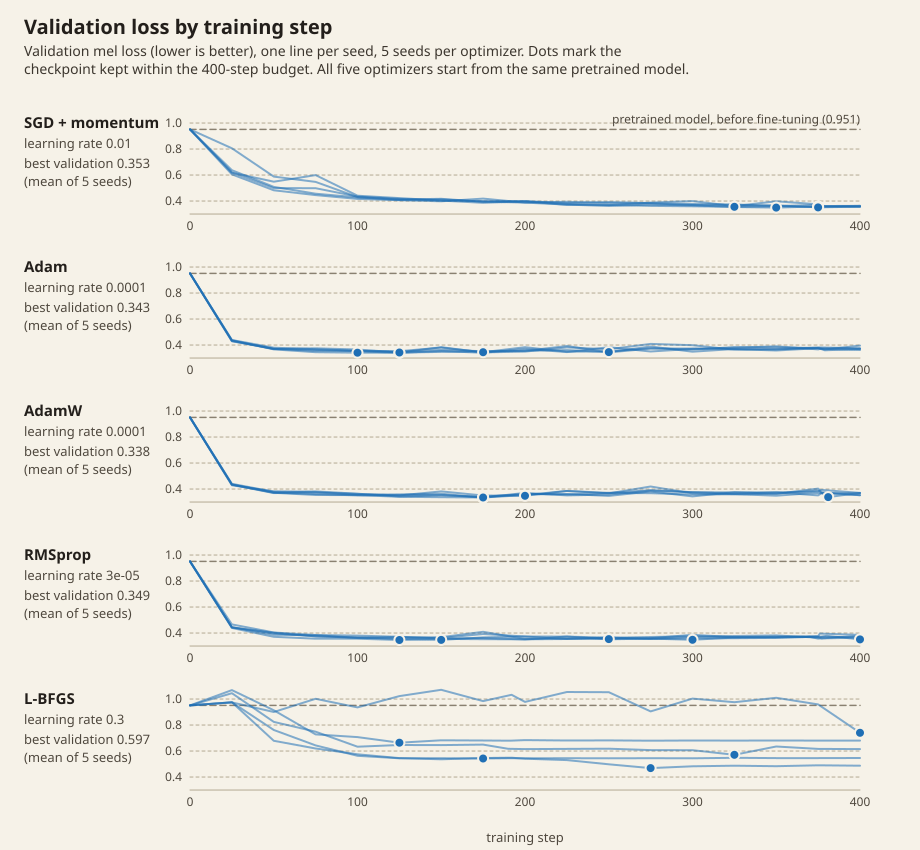
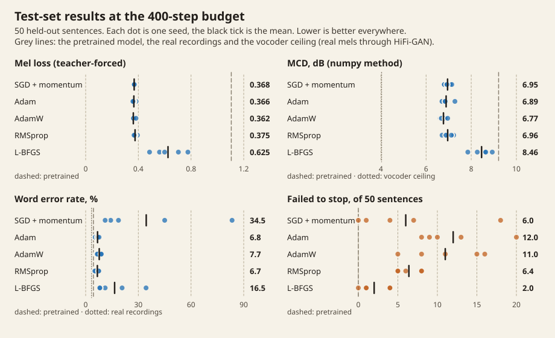

# Does the optimizer matter when fine-tuning a speech synthesiser?

An optimizer study with audio you can listen to. A pretrained Tacotron 2 (trained on LJSpeech) is fine-tuned to a new reader's voice with five optimizers: SGD with momentum, Adam, AdamW, RMSprop and L-BFGS. Each optimizer is tuned on a validation set, run with 5 seeds under equal step and time budgets, and scored once on held-out test sentences.

This is v2 of a Math 132A course project. The original version, with a note on its limitations, is in [`v1-course-project/`](v1-course-project/).

Every number below is in [`results/results.json`](results/results.json), produced from the run logs by `scripts/export_results.py`. Figures are in [`results/figures/`](results/figures/) and audio in [`results/audio/`](results/audio/).

## Findings

**a. The four first-order optimizers can't be told apart.** On the primary metric (teacher-forced mel loss on the test set, 400-step budget), SGD with momentum, Adam, AdamW and RMSprop land within 0.013 of each other, and every difference is inside the seed spread under the rules fixed before the runs. AdamW has the lowest mean (0.362), but that is not a win:
- At learning rate 1e-4, AdamW's weight decay of 0.01 shrinks the weights by a factor of at least 0.9996 over 400 steps, so it is practically the same optimizer as Adam.
- With identical data order and dropout masks, Adam and AdamW still differ by more than the gap between the four means: seed 0 gives 0.383 against 0.349.
- That gap is what this setup's noise looks like.

**b. L-BFGS is clearly worse.** It ends at 0.625 mel loss against 0.36–0.38 for the others (95% CI of the difference to AdamW: +0.24 to +0.29), and its MCD is 1.7 dB higher. It is also twice as slow per step. The caveat: **it never line-searched.** Every one of its 2,000 steps across the five final runs used exactly two loss evaluations, meaning the strong-Wolfe line search accepted the first trial step every time. So this tests L-BFGS as a fixed step of 0.3 along curvature estimated from noisy 16-clip batches, not L-BFGS at its best.

**c. The main finding: the agreed metrics missed the model's worst failure.** Fine-tuned models often fail to stop. The stop token never fires, and the model keeps generating until the 1,000-frame (11.6 s) limit.
- **How often:** about 6 of the 50 test sentences on average for SGD and RMSprop, 11 for AdamW and 12 for Adam. The pretrained model never failed to stop.
- **What it sounds like:** sometimes a quiet tail, sometimes a loud constant tone. On test sentence 2 (*"Stay!--stay!--How strange that it should not have occurred to me before!"*), the AdamW clip speaks the sentence correctly and then holds a tone at about ten times the speech's level (RMS 0.49 against 0.047) for 6.5 seconds.
- **The recogniser missed it:** Whisper transcribed that clip with **zero word errors out of 13**. Across all 25 runs, the models failed to stop on 187 test sentences, and Whisper scored 83 of them (44%) as error-free. MCD is computed on DTW-aligned frames after trimming silence, so it barely registers a long tail either.
- **Checkpoint selection can't see it:** the best checkpoint is chosen on teacher-forced mel loss, where the model is fed the real previous frame and never has to stop on its own.

**d. Fine-tuning moved the voice toward the reader but made it less intelligible.**

| System | MCD | WER |
|---|---|---|
| Pretrained model | 9.21 dB | 4.4% |
| Fine-tuned, first-order optimizers | 6.8–7.0 dB | 6.7–7.7% (SGD 34.5%) |
| Real recordings, through the vocoder | 4.03 dB | — |
| Real recordings | — | 3.3% |

MCD is the distance to the real recording. The first-order models cover roughly half the distance between the pretrained model and the vocoder's ceiling. Every fine-tuned model is less intelligible than the pretrained one.

## Results

Test set (50 sentences), mean ± sd over 5 seeds. Per-seed values are in `results.json → final`.

**400-step budget**

| Optimizer | Learning rate | Mel loss | MCD (dB) | WER (%) | Failed to stop (of 50) |
|---|---|---|---|---|---|
| SGD + momentum | 1e-2 | 0.368 ± 0.003 | 6.95 ± 0.15 | 34.5 ± 30.4 | 6.0 ± 7.2 |
| Adam | 1e-4 | 0.366 ± 0.010 | 6.89 ± 0.23 | 6.8 ± 1.1 | 12.0 ± 4.8 |
| AdamW | 1e-4 | 0.362 ± 0.012 | 6.77 ± 0.13 | 7.7 ± 1.3 | 11.0 ± 4.6 |
| RMSprop | 3e-5 | 0.375 ± 0.010 | 6.96 ± 0.21 | 6.7 ± 1.1 | 6.4 ± 1.5 |
| L-BFGS | 0.3 | 0.625 ± 0.116 | 8.46 ± 0.41 | 16.5 ± 11.3 | 2.0 ± 1.9 |
| *Pretrained model* | — | 1.106 | 9.21 | 4.4 | 0 |
| *Real recording through the vocoder* | — | — | 4.03 | 3.5 | — |
| *Real recording* | — | — | — | 3.3 | — |

**Time budget (828 s of training)**

| Optimizer | Mel loss | MCD (dB) | WER (%) | Failed to stop |
|---|---|---|---|---|
| SGD + momentum | 0.369 ± 0.003 | 7.00 ± 0.13 | 33.7 ± 31.2 | 6.0 ± 7.2 |
| Adam | 0.366 ± 0.010 | 6.89 ± 0.23 | 6.8 ± 1.1 | 12.0 ± 4.8 |
| AdamW | 0.362 ± 0.012 | 6.77 ± 0.13 | 7.7 ± 1.3 | 11.0 ± 4.6 |
| RMSprop | 0.374 ± 0.011 | 6.96 ± 0.21 | 6.9 ± 0.8 | 6.2 ± 1.6 |
| L-BFGS | 0.687 ± 0.169 | 8.46 ± 0.48 | 17.1 ± 5.4 | 1.2 ± 1.6 |

**Which differences are clear.** These rules were fixed in `scripts/summarize.py` before any results existed. A difference from the best optimizer counts as clear only if all three hold:
- the 95% paired bootstrap interval over test sentences excludes zero
- the five-seed ranges do not overlap
- the gap is at least 1% (1 point for WER)

The verdicts are the same at both budgets:

| Compared with AdamW | Mel loss | MCD | WER |
|---|---|---|---|
| L-BFGS | **clear** | **clear** | within noise |
| SGD + momentum | within noise | within noise | **clear** (+26.8 points) |
| Adam | within noise | within noise | within noise |
| RMSprop | within noise (the bootstrap interval +0.002 to +0.023 excludes zero, but the seed ranges overlap) | within noise | within noise |




Also in `results/figures/`: [`learning-curves-time.svg`](results/figures/learning-curves-time.svg) and [`stop-failures-by-checkpoint.svg`](results/figures/stop-failures-by-checkpoint.svg).

### Post-hoc checks (outside the pre-set rules)

- **SGD's word error rate, capped.** Some SGD sentences send Whisper into a repetition loop ("F-F-F-F…", "in, in, in…"), and each such loop adds about 90 errors to a sentence a few words long. With each sentence's errors capped at its own word count, SGD's WER falls from 34.5% to **22.9 ± 15.2%** (seed 1 still 49%). It is still the worst of the first-order methods, and no other optimizer changes. SGD's intelligibility really is the least reliable across seeds, but the uncapped figure overstates it.
- **When do stop failures appear?** Only the selected checkpoints were saved (at most two per run), so there are no full trajectories. Using every checkpoint that exists:
  - Adam already fails on 9–20 of 50 sentences at its earliest saved checkpoints (steps 100–125).
  - RMSprop fails on 5–8 at steps 125–150.
  - The five runs with two checkpoints never improve between them, and three get slightly worse (L-BFGS 1→4 and 0→1, RMSprop 5→6).

  So failures appear early. Whether they keep growing would need checkpoints saved during training.

## Method

- **Model.** SpeechBrain's pretrained [Tacotron 2](https://huggingface.co/speechbrain/tts-tacotron2-ljspeech) (28.2M parameters), fully fine-tuned. Its vocoder, [HiFi-GAN](https://huggingface.co/speechbrain/tts-hifigan-ljspeech) (13.9M), stays frozen. The loss is the recipe's own final-phase loss: mel MSE before and after the post-net plus stop-token BCE. Guided attention is off, matching the end of the original training.
- **Data.** One reader from LibriTTS-R train-clean-100, chosen by a fixed rule: the female reader with the most audio. That is speaker 40, with 34.9 minutes. Clips of 1–10 s are kept, which drops 92 long clips. The split is fixed by seed:
  - training: 176 clips (13.3 min)
  - validation: 25 clips (1.7 min)
  - test: 50 clips (3.7 min)
- **Training.** Batches of 16, with batches grouped by length to reduce padding (the same for every optimizer). First-order methods use gradient clipping at 1.0. L-BFGS uses strong-Wolfe line search, a history of 10, one iteration per step, and fixed dropout masks within each step.
- **Tuning.** Three learning rates per optimizer, half a decade apart, 150 steps on a separate seed, chosen by validation mel loss. Every chosen rate was the middle of its grid, so no grid extension was needed.
- **Final runs.** Seeds 0–4; the seed sets data order and dropout and is shared across optimizers. Each run trains until it has done 400 steps and used 828 s of training time. The time budget is 400 × Adam's median step time in tuning. For each budget, the checkpoint with the best validation mel loss is scored on the test set once.
- **Metrics.**
  - Teacher-forced post-net log-mel MSE.
  - MCD between the generated audio and the real recording. Mel-cepstra of order 24 (alpha 0.455), without c0, DTW-aligned, silence trimmed.
  - Word error rate from Whisper small.en (greedy decoding, Whisper's English text normaliser).
  - Failed to stop: the 1,000-frame decoder limit was reached.
- **Hardware.** One Apple M4 Pro laptop (PyTorch 2.14.1, MPS), runs one at a time, about 10 hours of running time in total.

## Limitations

- **The load threshold was set too low.** The rule flags runs with a mean load average above 6. This Mac's normal background load is 6–9, so 20 of 25 final runs are flagged. The flags do not appear to reflect distortion: within each optimizer, median step times stayed within 5% of each other (SGD 1.95–2.04 s, Adam 1.96–2.07 s, AdamW 1.95–2.07 s, RMSprop 1.96–2.12 s, L-BFGS 3.87–4.05 s). Excluding flagged runs leaves one seed per optimizer. L-BFGS is still last, and the first-order order reshuffles, which is consistent with "within noise".
- **The time budget only bites for L-BFGS.** It was set from Adam's median step time, which ran slightly below the mean, so first-order runs reached it at about step 380 and their time-budget results match their step-budget results. L-BFGS, at twice the cost per step, got about 200 steps.
- **Small data.** 13 minutes of training audio, 25 validation sentences and 50 test sentences, from one reader. The confidence intervals reflect the 50 test sentences, not other voices.
- **The MCD is computed in numpy and is not comparable with published SPTK numbers.** pysptk and pyworld could not be installed on this machine, so the mel-cepstrum comes from a liftered FFT cepstrum warped with SPTK's `freqt` recursion. It is tested in `tests/test_mcd.py` (including the property that the warped cepstrum reproduces the original log spectrum) and is consistent within this study, but its values differ from SPTK's `mcep`.
- **Selection is blind to stop failures.** Validation uses teacher-forced loss (see finding c).
- **The pretrained model was itself trained with Adam**, which could favour Adam-family optimizers in fine-tuning. The optimizer state was not released, so every run starts from fresh optimizer state.

## What I'd do next (not run)

1. Select checkpoints with a free-running validation that includes a stop check: generate the validation sentences and penalise failures to stop.
2. Make the failed-to-stop rate a first-class metric, reported and compared like mel loss.
3. Test whether a larger stop-token loss weight fixes the failures without costing voice similarity.

## Audio

[`results/audio/`](results/audio/) holds the five fixed test sentences, each as the real recording, the pretrained model, and every optimizer. Clips are mono 22.05 kHz MP3, 92 KB at most. Each optimizer's clips come from its median-seed run (by test mel loss), and they are the exact audio that was scored. Details per clip, including Whisper's transcript and tail measurements, are in [`results/audio/manifest.json`](results/audio/manifest.json).

**All model clips are synthetic speech.** Only sentences the reader actually recorded were synthesised, and each is paired with the real recording. No new text was generated in this voice.

**Tail volume.** Six published clips failed to stop. Four tails (SGD, sentences 1–4) are quiet and are published exactly as generated. Two (AdamW, sentences 1 and 2) end in loud tones at 7–10 times the level of the speech before them. **In those two clips, the tail's volume was reduced by 20 dB** (to one tenth of its amplitude), with a 50 ms fade. The tail starts 0.23 s after attention reaches its furthest character, which is 4.30 s into sentence 1 and 5.18 s into sentence 2. Nothing else in any clip was changed.

To hear the failure, compare sentence 2 from Adam ([`s2-adam.mp3`](results/audio/s2-adam.mp3), stops cleanly) with AdamW ([`s2-adamw.mp3`](results/audio/s2-adamw.mp3), failed to stop). Whisper scored both clips as perfect.

## Reproduce

```bash
uv sync
mkdir -p data && cp <LibriTTS-R doc>/SPEAKERS.txt data/      # from openslr.org/141 doc.tar.gz
curl -sL https://openslr.elda.org/resources/141/train_clean_100.tar.gz \
  | python -I scripts/stream_extract.py data/SPEAKERS.txt data/raw   # keeps female readers only
uv run python scripts/prepare_data.py                        # reader, splits, features
scripts/overnight.sh                                         # tuning + final runs + summary (~10 h)
uv run python scripts/export_audio.py
uv run python scripts/make_figures.py <commit>
uv run python scripts/export_results.py <commit>
uv run pytest tests
```

`scripts/overnight.sh` keeps the Mac awake, logs to `runs/study.log` and can be re-run after a stop or crash; finished runs are skipped. The runs in `results/` were made from commit `af156b3`.

## Data, models and credits

- **Speech data:** LibriTTS-R (Koizumi et al., 2023), [openslr.org/141](https://www.openslr.org/141/), licensed [CC BY 4.0](https://creativecommons.org/licenses/by/4.0/). It derives from LibriTTS and LibriVox public-domain audiobook recordings. The reader is identified here only by the corpus speaker ID, 40. The real recordings in `results/audio/` are resampled to 22.05 kHz and MP3-encoded. The synthetic clips are model outputs imitating that reader's voice and are labelled as such.
- **Models:** SpeechBrain Tacotron 2 and HiFi-GAN (LJSpeech), Apache-2.0. Whisper small.en, Apache-2.0. All are downloaded at run time and not included here.
- **Code:** MIT, see [LICENSE](LICENSE).
